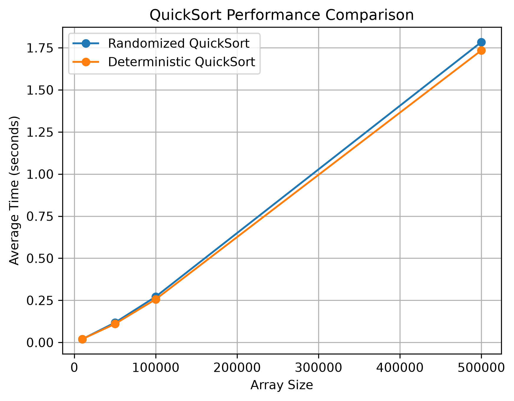

# Порівняння рандомізованого та детермінованого QuickSort

## Результати

Для порівняння ефективності алгоритмів було використано масиви розміром 10 000, 50 000, 100 000 та 500 000 елементів. Кожен алгоритм запускався 5 разів, після чого обчислювався середній час виконання.

| Розмір масиву | Рандомізований QuickSort | Детермінований QuickSort |
| ------------------------: | -------------------------------------: | -------------------------------------: |
|                    10 000 |                            0.019949 с |                            0.020002 с |
|                    50 000 |                            0.117514 с |                            0.109767 с |
|                   100 000 |                            0.271593 с |                            0.256097 с |
|                   500 000 |                            1.783994 с |                            1.734444 с |

## Графік

## Аналіз результатів

За результатами проведеного експерименту обидва алгоритми показали подібну продуктивність на масивах випадкових цілих чисел.

Для масиву розміром 10 000 елементів різниця між алгоритмами практично відсутня: 0.019949 с для рандомізованого QuickSort та 0.020002 с для детермінованого.

Для більших масивів у цьому експерименті детермінований QuickSort показав менший середній час виконання. На масиві з 500 000 елементів його середній час становив 1.734444 с проти 1.783994 с у рандомізованого алгоритму.

При збільшенні розміру масиву час виконання обох алгоритмів закономірно збільшується. При цьому різниця між двома підходами залишається відносно невеликою.

Результати можуть залежати від конкретних вхідних даних, випадкового вибору опорного елемента та умов виконання програми.

## Висновки

У проведеному експерименті обидві реалізації QuickSort успішно відсортували тестові масиви та продемонстрували близьку ефективність.

На використаних випадкових масивах детермінований QuickSort у більшості тестів показав трохи менший середній час виконання. Рандомізація вибору опорного елемента не гарантує меншого часу виконання на кожному конкретному наборі даних, але змінює стратегію вибору pivot та може впливати на поведінку алгоритму на інших типах вхідних даних.
